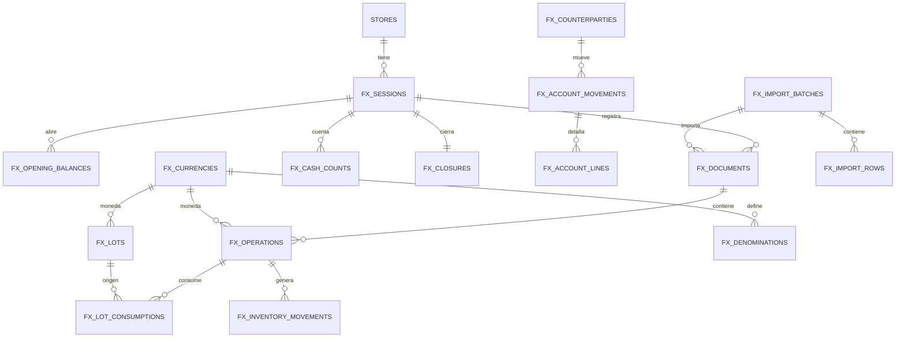

# Caja Temuco — Análisis de Excel, arquitectura de datos y propuesta de interfaz

> Documento de diseño funcional y técnico para el módulo de casa de cambio/divisas.
> Base analizada: `Reporte.xlsx` y `CAJA TEMUCO V5.xlsx`.
> Fecha de análisis: 2026-11-04.

---

## 1. Resumen ejecutivo

### Recomendación

Implementar un **proyecto independiente** con **Vite + React 19 + TypeScript + Supabase/PostgreSQL**, separado de NEXO.

Motivos:

1. El alcance es una casa de cambio, no un ERP de tiendas; mezclarlo con NEXO agrega dependencias y riesgo.
2. La operación requiere **transacciones atómicas** (FIFO + inventario + cuentas corrientes + cierres mayoristas + cierre diario). PostgreSQL lo resuelve de forma natural.
3. La casa de cambio necesita **histórico, trazabilidad por folio, roles y respaldo**. Supabase provee esa base.
4. Un panel interno en React permite formularios densos, tablas, importación de Excel y reportes imprimibles sin arrastrar el modelo de datos de NEXO.

### Hallazgo principal

Los Excel actuales **no implementan FIFO**. `MES` valoriza el inventario con **promedio ponderado diario** (`SUMA(CLP) / SUMA(divisa)`). `DEUDAS TCO` queda **fuera de alcance** por decisión del negocio. Por lo tanto, el FIFO debe construirse como un libro nuevo de capas (`fx_lots`) y consumos (`fx_lot_consumptions`), usando las compras históricas como fuente para sembrar las capas iniciales.

### Entregables incluidos

- Este documento de análisis y diseño.
- Migración de referencia: `supabase/migrations/202611040002_fx_casa_cambio.sql`.
- Núcleo de dominio puro: `src/lib/domain/fx.ts`.
- Pruebas: `tests/fx.test.mts`.

La migración queda preparada pero **no aplicada** al Supabase remoto, igual que las migraciones de referencia del repositorio.

---

## 1.b Aclaraciones del negocio (alcance definitivo)

Estas definiciones reemplazan cualquier supuesto anterior del documento:

- **ST = boleta nula.** Se registra solo para auditoría y **no se considera para nada**: no suma compras, ventas, CLP, promedios, margen, inventario ni cuentas.
- **`DEUDAS TCO` no se considera.** Queda fuera del alcance y de la migración. No se usa como fuente FIFO ni como cuenta corriente.
- **No hay una “fecha de corte” fija.** Los reportes deben permitir **semana, mes, año y rango personalizado**. El histórico se consulta por período.
- **`ARGENTINO T` = peso argentino por transferencia.** Se modela como `ARS` con `instrument = TRANSFERENCIA`, separado del peso argentino efectivo para conservar sus promedios.
- **Mayoristas:** se pacta por teléfono una divisa a un precio fijo con un proveedor/cliente. Luego se hacen depósitos o pagos en efectivo para cuadrar, por lo que pueden quedar **saldos pendientes de ambas partes**. Se modela con `fx_wholesale_deals` (cabecera pactada) y `fx_wholesale_settlements` (entregas de divisa y pagos/cobros CLP).
- **Cuentas bancarias:** se tratan como contrapartes de tipo **`BANCO`** dentro de cuentas corrientes. No se crea un módulo bancario separado.
- **Gastos:** debe existir un **cuadro de gastos** por categoría y por período, además del detalle diario. Cada gasto descuenta caja CLP y resultado.

## 2. Lectura de los archivos

### 2.1 `Reporte.xlsx`

| Propiedad | Valor |
|---|---|
| Hojas | `Hoja1` |
| Filas de datos | 1.142 |
| Columnas | `OPERACION`, `CAJERO`, `DOCUMENTO`, `FOLIO`, `MONEDA`, `FECHA`, `RUT`, `NOMBRE`, `MONTO_EXTRANJERA`, `TIPO_CAMBIO`, `MONTO_NACIONAL` |
| Rango de fechas | 2026-09-01 a 2026-11-03 (46 días con movimiento) |
| Operaciones | 832 compras, 310 ventas |
| Documentos | 100% `BOLETA` |
| Cajero | 100% `asantibanez` |
| RUT / NOMBRE | 100% vacíos |
| Monedas | `DOLAR` (746), `PESO ARGENTINO` (278), `ARGENTINO T` (42), `EUROS` (41), `REAL BRASIL` (28), `DÓLAR AUSTRALIANO` (6), `PESO MEXICANO` (1) |

Observaciones:

- `FECHA` viene como texto `dd-mm-yyyy`; debe parsearse explícitamente.
- `MONEDA` tiene espacios no separables (`\xa0`) y etiquetas inconsistentes.
- `ARGENTINO T` parece ser **peso argentino por transferencia** y no una moneda distinta. Conviene modelarlo como `ARS` + `instrumento = TRANSFERENCIA`, sin mezclarlo silenciosamente con `PESO ARGENTINO` en los promedios si el negocio los opera a tasas distintas.
- **25 folios se repiten** porque una misma boleta puede tener varias líneas de moneda. Ejemplo: folio 76978 tiene DOLAR + PESO ARGENTINO + EUROS. Por lo tanto, `FOLIO` **no es único por fila**; la clave natural es `(documento, folio, moneda, línea)`.
- **17 filas tienen folio 0**: son boletas sin folio registrado. Deben quedar marcadas como “sin folio” y no confundirse con duplicados.
- No existe una columna `ST` ni un estado de anulación. El control de boletas ST debe agregarse como tabla/estado propio.
- `MONTO_EXTRANJERA × TIPO_CAMBIO = MONTO_NACIONAL` se cumple en las 1.142 filas (diferencia ≤ 1), lo que permite validar la importación.
- No hay timestamps ni orden intra-día. Para FIFO se usará `fecha + folio + línea + orden de importación`.

### 2.2 `CAJA TEMUCO V5.xlsx`

| Hoja | Filas × columnas | Uso observado |
|---|---:|---|
| `DEUDAS TCO` | 200 × 69 | **Fuera de alcance** por decisión del negocio; no se migra ni se usa |
| `MES` | 3.756 × 130 | Libro diario ancho: 18 pares compra/venta por moneda, resumen de capital y utilidad |
| `LIBRO DIARIO` | 378 × 10 | Encabezado `Fecha/Nombre/Monto/Moneda/Concepto`; **sin datos** en la muestra |
| `AD` | 4 × 3 | Tabla dinámica vacía |
| `GASTOS` | 273 × 7 | `Fecha/Concepto/Total/Comentario`; **sin datos** en la muestra |
| `CUADRATURA` | 49 × 72 | Conteo físico por denominación para CLP + 17 divisas, con diferencias contra `MES` |

#### Hoja `MES`

- Zona de transacciones: filas 8 a 3389.
- Columnas:
  - `H`: folio de compra.
  - `I`: folio de venta.
  - `J`: fecha.
  - Bloques de 3 columnas por divisa: `IMP` (cantidad), `COTIZ` (tipo de cambio), `$` (CLP).
  - 18 pares compra/venta: USD, ARS, BRL, EUR, NZD, AUD, CAD, COP, PEN, GBP, BOB, UYU, MXN, CHF, PYG y dos pares “NEW”.
- Fila 8: saldo inicial `50.000 USD @ 925 = 46.250.000 CLP`.
- Filas 3395–3400: `INICIAL`, `UTILIDAD`, `UT SEGUROS`, `UT TRANSFERENCIAS`, `GASTOS`, `TOTAL`.
- Fórmulas clave:
  - `M6 = N6 / L6`: cotización promedio ponderada de compra USD.
  - `P6 = Q6 / O6`: cotización promedio ponderada de venta USD.
  - `A3`: caja CLP final luego de flujos.
  - `A7`: capital final valorizado a promedio (`caja + inventario × cotización promedio`).
- **Limitación:** solo hay 26 filas con datos (8, 9 y 10 de septiembre de 2026), mientras `Reporte.xlsx` tiene 1.142 filas hasta el 3 de noviembre. La planilla es una **plantilla parcial**, no el histórico completo.

#### Hoja `DEUDAS TCO`

- La hoja existe, pero **queda fuera de alcance** por decisión del negocio.
- No se migra, no se usa como fuente FIFO y no se muestra en la app.
- `finde` = fin de semana; `depo` = depósito. No se necesita interpretar el resto para este proyecto.

#### Hoja `CUADRATURA`

- 17 bloques de moneda: CLP + 16 divisas (USD, ARS, BRL, EUR, NZD, AUD, CAD, COP, PEN, GBP, BOB, UYU, MXN, CHF, PYG, NEW, NEW).
- Cada bloque: `Q` (cantidad), `IMPORTE` (denominación), `TOTAL = Q × IMPORTE`, `COMENTARIO`.
- Filas 3–14: denominaciones (en CLP: 10, 50, 100, 500, 1.000, 2.000, 5.000, 10.000, 20.000).
- Filas 16–27: conteo “CAJA TEMUCO”.
- Fila 28: `ENCAJES` (otros activos, hoy alimentados por `LIBRO DIARIO`).
- Fila 31: total contado.
- Fila 32: saldo esperado desde `MES`.
- Fila 33: diferencia por moneda.
- En la muestra hay diferencias: CLP 8.477.998; USD −8.630; ARS −932.600; GBP +30; MXN +550; CHF +290; PYG +760.000. Son consistentes con una plantilla incompleta, no con un cierre real.

#### `LIBRO DIARIO`, `GASTOS`, `AD`

- `LIBRO DIARIO` solo tiene encabezado; se usa para `ENCAJES` mediante `SUMIFS`.
- `GASTOS` solo tiene encabezado y total 0.
- `AD` está vacía.

Conclusión: la planilla actual **no contiene un histórico completo ni un FIFO utilizable**. Sirve como especificación de campos, denominaciones y reportes, pero el sistema nuevo debe construir su propio libro transaccional.

---

## 3. Hallazgos, riesgos y decisiones de diseño

| # | Hallazgo | Riesgo | Decisión propuesta |
|---|---|---|---|
| 1 | Un folio puede tener varias monedas | Duplicar o anular una boleta completa por error | Separar `fx_documents` (cabecera) y `fx_operations` (líneas). ST se aplica al documento/folio completo. |
| 2 | Folio 0 repetido | Chocar con la unicidad de folio | Marcar `missing_folio`; no aplicar índice único a folios `0`/vacíos; agrupar por fila de origen. |
| 3 | Etiquetas de moneda inconsistentes | Promedios y stock separados artificialmente | Tabla `fx_currency_aliases` + normalización de espacios/Mayúsculas. `ARGENTINO T` → ARS + instrumento TRANSFERENCIA. |
| 4 | Sin timestamps | FIFO ambiguo dentro del día | Orden: `business_date`, `folio`, `line_no`, `import_sequence`. |
| 5 | Sin columna ST | No se puede excluir con certeza | Tabla `fx_st_folios` + estado `VOID_ST` en el documento. Exclusión obligatoria en vistas y funciones. |
| 6 | `MES` usa promedio ponderado | El “costo” actual no es FIFO | Libro de lotes `fx_lots` y consumos `fx_lot_consumptions`. El promedio queda solo como estadística. |
| 7 | `DEUDAS TCO` no tiene saldo ni vínculo | No se puede reconstruir automáticamente | **Fuera de alcance**: no se migra ni se usa. |
| 8 | `LIBRO DIARIO` vacío | `ENCAJES` no tiene fuente | Modelar `fx_other_assets` o `fx_inventory_movements` con tipo `ENCAJE`; no depender de una hoja vacía. |
| 9 | CLP se mezcla con capital | Diferencia de cuadratura mal interpretada | Separar `caja CLP` de `capital total`; el capital incluye inventario FIFO valorizado. |
| 10 | Inventario puede quedar negativo | FIFO sin capa suficiente | Bloquear la operación y exigir apertura/ajuste; en migración, permitir `allow_short` solo con auditoría. |
| 11 | Redondeo CLP vs divisa | Diferencias de centavos | CLP con `numeric(20,2)`; cantidades `numeric(24,6)`; tipo de cambio `numeric(20,8)`; redondear solo al registrar el asiento. |
| 12 | Datos sensibles y multi-tienda | Fuga entre tiendas | `store_id` en todas las tablas y RLS con `is_store_member(store_id)`. |

---

## 4. Modelo de dominio y reglas contables

### 4.1 Entidades principales

- **Sesión diaria** (`fx_sessions`): un día operativo por tienda.
- **Apertura** (`fx_opening_balances` + capas FIFO): saldos iniciales por divisa y su costo.
- **Documento** (`fx_documents`): boleta/factura/ticket, folio, estado, mayorista, contraparte.
- **Operación** (`fx_operations`): línea de compra/venta de una divisa.
- **Lote FIFO** (`fx_lots`): entrada de inventario con cantidad original, remanente y costo unitario CLP.
- **Consumo FIFO** (`fx_lot_consumptions`): qué lote se usó en cada salida.
- **Movimiento de inventario** (`fx_inventory_movements`): libro auditable de entradas/salidas por divisa, incluyendo CLP.
- **Cuenta corriente** (`fx_counterparties`, `fx_account_movements`, `fx_account_lines`): deudores/acreedores por persona y divisa.
- **Conteo físico** (`fx_cash_counts`): denominación, cantidad, total, diferencia.
- **Cierre** (`fx_closures`): snapshot del día y resultados.
- **Gasto** (`fx_expenses`): egreso en CLP o divisa.

### 4.2 Convención de signos

Para cada moneda se mantiene una cantidad `Q` y un costo FIFO `C` en CLP. La caja CLP es la moneda `CLP` con costo unitario 1.

| Evento | Inventario divisa | Caja CLP | Deudores | Acreedores | Resultado |
|---|---:|---:|---:|---:|---:|
| Compra de divisa al contado | +Q | −CLP | — | — | — |
| Venta de divisa al contado | −Q | +CLP | — | — | + margen realizado |
| Compra a crédito | +Q | — | — | +CLP | — |
| Venta a crédito | −Q | — | +CLP | — | + margen realizado |
| Préstamo otorgado en divisa | −Q | — | +Q | — | — |
| Préstamo recibido en divisa | +Q | — | — | +Q | — |
| Cobro de deuda en la misma divisa | +Q | — | −Q | — | — |
| Pago de deuda en la misma divisa | −Q | — | — | −Q | — |
| Cobro de deuda en CLP | — | +CLP | −Q | — | ± diferencia FX |
| Pago de deuda en CLP | — | −CLP | — | −Q | ± diferencia FX |
| Gasto | — | −CLP | — | — | −gasto |
| Ajuste de inventario | ±Q | — | — | — | ± ajuste |

Reglas:

- El **margen realizado** de una venta es `CLP cobrado − costo FIFO de las unidades vendidas`.
- Una **compra** no genera utilidad; solo crea una capa al costo exacto `CLP / cantidad`.
- Un **préstamo** no genera utilidad en el momento; mueve inventario a cuenta corriente (o viceversa).
- La **valorización FIFO** del inventario remanente es `Σ(remanente × costo_unitario)`.
- El **capital total** es `caja CLP + valorización FIFO de todas las divisas + encajes`.
- El **resultado del día** es `margen realizado + diferencias FX de cuentas + otros ingresos − gastos`.

### 4.3 Boletas nulas (ST)

Modelo:

- Tabla `fx_st_folios` con `store_id`, `document_type`, `folio`, `status` (`ACTIVE`/`REVERSED`), `reason`, `registered_by`, `registered_at`, `reversed_by`, `reversed_at`.
- Al importar, si un folio está `ACTIVE`, el documento se crea con `status = 'VOID_ST'`.
- Las operaciones se guardan igual (para auditoría), pero **todas las vistas de cálculo filtran `status = 'VALID'`**.
- Si se ingresa un ST después de importar, se actualiza el documento a `VOID_ST` y se registra el evento.
- Si se reversa el ST, el documento vuelve a `VALID` solo si no tiene otra causal de anulación.
- Si el documento ya consumió lotes FIFO, la reversión debe **restaurar exactamente los consumos** (`fx_reverse_sale_fifo`). Para una compra ya consumida, no se debe borrar el lote: se bloquea y se exige un ajuste, para no corromper el FIFO.

Regla estricta: **ningún cálculo de compra, venta, CLP, promedio, margen o inventario puede incluir un documento `VOID_ST`**. Se implementa en la vista `fx_valid_operations` y en las funciones de estadística/cierre; no se confía en el filtro de la UI.

### 4.4 FIFO

Cada entrada crea una capa:

- Compra: `original_qty = cantidad`, `remaining_qty = cantidad`, `unit_cost_clp = CLP / cantidad`.
- Apertura: capa(s) con costo explícito. Si se arrastra el cierre anterior, se copian **las capas remanentes**, no solo el total.
- Préstamo recibido: capa con costo según tasa pactada o tasa de mercado informada.
- Devolución de préstamo otorgado: capa con el costo promedio de las capas consumidas al otorgarlo.

Cada salida consume capas en orden `acquired_at, sequence`:

```
need = cantidad_salida
para cada lote con remaining_qty > 0, ordenado por acquired_at, sequence:
    take = min(lote.remaining_qty, need)
    lote.remaining_qty -= take
    registrar consumo(lote, take, costo = take × lote.unit_cost_clp)
    need -= take
si need > 0: error de inventario insuficiente
```

Consideraciones:

- El orden intra-día usa `business_date`, `folio`, `line_no`, `import_sequence`.
- Si una venta ocurre antes de la compra del mismo día, el FIFO solo puede usar capas anteriores; si no alcanza, se bloquea. Esto evita “inventario negativo” silencioso.
- Para migración histórica se procesa en orden cronológico; si falta una capa inicial, se crea una apertura explícita antes del primer movimiento.
- Los consumos se guardan con `reversed_at` para permitir anulación auditable.

### 4.5 Cuentas corrientes

- `fx_counterparties`: personas, empresas, proveedores, terceros.
- `fx_account_movements`: cabecera (fecha, contraparte, tipo, nota, sesión, estado).
- `fx_account_lines`: una línea por divisa y lado:
  - `side = 'RECEIVABLE'` (nos deben).
  - `side = 'PAYABLE'` (les debemos).
  - `amount_delta` con signo: positivo aumenta el lado, negativo lo disminuye.
- Saldo por contraparte/divisa:
  - `deudor = Σ(amount_delta) donde side = RECEIVABLE`.
  - `acreedor = Σ(amount_delta) donde side = PAYABLE`.
  - `neto = deudor − acreedor`.
- Un movimiento puede tener varias líneas (por ejemplo, deuda en USD pagada en CLP). Cada línea guarda `fx_rate` y `clp_equivalent` para medir la diferencia FX.
- La UI muestra una matriz contraparte × divisa con columnas “Nos deben” y “Les debemos”, y el neto.

### 4.6 Cuadratura

Para cada divisa:

```
esperado = apertura
         + compras
         − ventas
         + préstamos recibidos
         − préstamos otorgados
         + cobros de deuda
         − pagos de deuda
         ± ajustes
         ± traslados/encajes
```

Para CLP:

```
esperado_clp = apertura_clp
             − compras_de_divisa (CLP pagado)
             + ventas_de_divisa (CLP cobrado)
             + cobros_en_clp
             − pagos_en_clp
             − gastos
             ± ajustes
```

Conteo físico:

```
contado = Σ(cantidad_denominación × valor_denominación)
diferencia = contado − esperado
```

El cierre guarda `esperado`, `contado`, `diferencia` y comentario por divisa. Una diferencia distinta de cero no impide cerrar, pero exige comentario y queda en auditoría.

### 4.7 Cierre y resultados

El reporte de cierre se construye en este orden:

1. Saldo inicial por divisa (cantidad + costo + CLP).
2. Movimientos del día (compras/ventas netas, promedio ponderado de compra/venta).
3. Ventas mayoristas (tickets).
4. Deudores y acreedores por persona/divisa.
5. Conteo físico por denominación y diferencias.
6. Histórico mensual acumulado.

Además, el cierre guarda:

- Valorización FIFO del inventario remanente.
- Caja CLP.
- Capital total.
- Margen realizado.
- Diferencias FX.
- Gastos.
- Resultado neto.

---

## 5. Estructura de base de datos

### 5.1 Diagrama entidad-relación



### 5.2 Tablas

#### Configuración

- `fx_currencies(code, name, symbol, decimals, is_base, is_active, sort_order)`.
- `fx_currency_aliases(alias, currency_code)`.
- `fx_denominations(id, currency_code, value, kind, sort_order)`.
- `fx_cashiers(id, store_id, name, is_active)`.

#### Operación diaria

- `fx_sessions(id, store_id, business_date, status, opening_mode, previous_session_id, opened_by, closed_by, opened_at, closed_at, notes)`.
- `fx_opening_balances(session_id, currency_code, quantity, unit_cost_clp, clp_value, source, note)`.
- `fx_documents(id, store_id, session_id, business_date, operation, document_type, folio, cashier, counterparty_id, is_wholesale, ticket_code, status, void_reason, voided_at, voided_by, import_batch_id, source_row_first, source_row_last, missing_folio)`.
- `fx_operations(id, store_id, document_id, session_id, business_date, operation, currency_code, instrument, foreign_amount, fx_rate, clp_amount, line_no, source_row, raw)`.

#### Importación

- `fx_import_batches(id, store_id, session_id, file_name, file_hash, sheet_name, status, rows_total, rows_valid, rows_void, rows_error, mapping, errors, created_by, created_at, committed_at)`.
- `fx_import_rows(id, store_id, batch_id, row_number, raw, normalized, status, error, document_id, operation_id)`.

#### ST

- `fx_st_folios(id, store_id, document_type, folio, reason, status, registered_by, registered_at, reversed_by, reversed_at, note)`.

#### FIFO e inventario

- `fx_lots(id, store_id, currency_code, session_id, source_type, source_operation_id, source_account_movement_id, acquired_at, sequence, original_qty, remaining_qty, unit_cost_clp, note, created_at)`.
- `fx_lot_consumptions(id, store_id, lot_id, operation_id, account_movement_id, quantity, unit_cost_clp, total_cost_clp, consumed_at, reversed_at)`.
- `fx_inventory_movements(id, store_id, session_id, currency_code, movement_type, quantity_delta, unit_cost_clp, clp_delta, reference_type, reference_id, business_date, note, created_at)`.

#### Cuentas corrientes

- `fx_counterparties(id, store_id, name, rut, kind, phone, email, notes, is_active, created_at)`.
- `fx_account_movements(id, store_id, session_id, counterparty_id, movement_type, business_date, status, reverses_id, note, created_by, created_at)`.
- `fx_account_lines(id, store_id, movement_id, currency_code, side, amount_delta, fx_rate, clp_equivalent, note)`.

#### Conteo, cierre y gastos

- `fx_cash_counts(id, store_id, session_id, currency_code, denomination_id, quantity, total, counted_by, note, created_at)`.
- `fx_closures(id, store_id, session_id, business_date, status, total_cash_clp, total_inventory_clp, total_capital_clp, realized_margin_clp, fx_result_clp, expenses_clp, net_result_clp, snapshot, notes, closed_by, closed_at)`.
- `fx_expenses(id, store_id, session_id, business_date, concept, category, amount_clp, currency_code, amount_currency, fx_rate, note, created_by, created_at)`.

### 5.3 Vistas de cálculo

- `fx_valid_operations`: operaciones cuyo documento está `VALID`. **Es la única fuente para compras/ventas.**
- `fx_daily_currency_stats`: por tienda/fecha/divisa, cantidades y CLP de compra/venta, promedios ponderados.
- `fx_inventory_valuation`: por tienda/divisa, cantidad remanente y valor FIFO.
- `fx_account_balances`: por contraparte/divisa, deudor, acreedor y neto.
- `fx_session_summary`: resumen de la sesión (apertura, movimientos, inventario, cuentas, gastos, conteo).

### 5.4 RLS

Todas las tablas con `store_id` usan:

```sql
ALTER TABLE ... ENABLE ROW LEVEL SECURITY;
CREATE POLICY ... FOR ALL TO authenticated
  USING (public.is_store_member(store_id))
  WITH CHECK (public.is_store_member(store_id));
```

Las tablas globales (`fx_currencies`, `fx_currency_aliases`, `fx_denominations`) son de lectura para `authenticated`; la escritura queda para `service_role` o para un rol administrador explícito.

### 5.5 Índices y rendimiento

- `fx_documents (store_id, business_date, status)`.
- `fx_documents (store_id, document_type, folio)` parcial `WHERE folio <> '0'`.
- `fx_operations (store_id, business_date, currency_code, operation)`.
- `fx_lots (store_id, currency_code, acquired_at, sequence) WHERE remaining_qty > 0`.
- `fx_lot_consumptions (operation_id)`.
- `fx_account_lines (store_id, counterparty_id, currency_code)`.
- `fx_cash_counts (session_id, currency_code)`.

---

## 6. Interfaz de usuario

### 6.1 Navegación

Agregar un grupo “Casa de cambio” en el sidebar existente:

- **Divisas** (dashboard)
- **Apertura**
- **Importar reporte**
- **Operaciones**
- **Cuentas corrientes**
- **Cuadratura**
- **Cierre**
- **Histórico**
- **Configuración**

Como `AppShell` es un shell de pestañas, la opción de menor fricción es un ítem “Divisas” con sub-pestañas internas. Si se necesita enlace directo, se puede migrar a rutas `/divisas/*` manteniendo el mismo layout.

### 6.2 Pantallas

#### A. Apertura

- Selector de fecha.
- Switch:
  - **Arrastrar cierre anterior** (recomendado): copia saldos y capas FIFO del cierre anterior.
  - **Manual**: tabla editable por divisa con cantidad y costo unitario CLP.
- Tabla:
  - Divisa, cantidad, costo unitario, valor CLP, origen.
  - Para CLP, costo unitario fijo 1.
- Validaciones:
  - No permitir dos aperturas para la misma fecha/tienda.
  - Si no hay cierre anterior, obligar manual.
  - Si se copia el cierre anterior, mostrar las capas FIFO que se arrastran (no solo el total).
- Botón “Abrir día”.

#### B. Importar reporte

- Dropzone `.xlsx`.
- Selector de hoja.
- Vista previa con columnas normalizadas.
- Chips de estado por fila: `Válida`, `ST`, `Duplicada`, `Error`, `Sin folio`.
- Caja de texto para folios ST:
  - Un folio por línea.
  - Soporte de rangos: `76876`, `76991-77000`.
  - Botón “Aplicar ST”.
- Resumen:
  - Filas leídas, válidas, ST excluidas, duplicadas, errores.
  - Total compras/ventas por divisa.
- Botón “Confirmar importación” (transacción).
- Historial de importaciones con opción “Reversar lote” (solo si no hay dependencias).

#### C. Operaciones

- Filtros: fecha, divisa, operación, estado, cajero, folio, contraparte, mayorista.
- Tabla con:
  - Fecha, folio, documento, operación, divisa, cantidad, TC, CLP, estado, mayorista.
- Acciones:
  - Ver detalle.
  - Marcar/desmarcar mayorista.
  - Anular por ST u otra causal.
  - Reversar ST.
- Totales sticky por divisa.

#### D. Cuentas corrientes

- Panel izquierdo: contrapartes con saldo neto.
- Panel derecho: detalle por divisa.
- Matriz:
  - Filas: contraparte.
  - Columnas: deudor/acreedor por divisa + neto CLP referencial.
- Modal “Nuevo movimiento”:
  - Tipo: préstamo otorgado/recibido, cobro, pago, venta a crédito, compra a crédito, ajuste.
  - Contraparte.
  - Divisa.
  - Monto.
  - Tipo de cambio y equivalente CLP.
  - “Afecta inventario/caja” (calculado según tipo).
  - Nota.
- Modal “Liquidar”:
  - Permite pagar una deuda en otra divisa.
  - Muestra diferencia FX estimada.

#### E. Cuadratura

- Pestañas por divisa (CLP, USD, ARS, …).
- Grid de denominaciones:
  - Denominación, cantidad, total.
  - Fila “Otra denominación” para valores no configurados.
- Totales:
  - Contado, esperado, diferencia.
- Comentario obligatorio si la diferencia ≠ 0.
- Barra superior:
  - Capital CLP, caja CLP, inventario FIFO, margen realizado.
- Botón “Guardar conteo”.
- Botón “Cerrar día” con checklist:
  - Todos los conteos guardados.
  - Sin diferencias sin comentario.
  - Sin documentos en estado dudoso.

#### F. Cierre

Reporte jerárquico imprimible:

1. Saldo inicial.
2. Movimientos del día.
3. Ventas mayoristas.
4. Deudores y acreedores.
5. Conteo físico y diferencias.
6. Histórico mensual.

Incluye:
- Valorización FIFO.
- Caja CLP.
- Capital total.
- Margen realizado.
- Gastos.
- Resultado neto.
- Firmas/responsables.
- Exportar PDF/Excel.

#### G. Histórico

- Gráfico mensual de tipos de cambio promedio de compra/venta por divisa.
- Barras de volumen.
- Tabla mensual con promedios ponderados (no promedio de promedios).
- Comparación mes actual vs mes anterior.

#### H. Configuración

- Monedas y alias.
- Denominaciones por divisa.
- Cajeros.
- Tipos de documento.
- Reglas de apertura.
- Roles/permisos.

### 6.3 Wireframe resumido

```text
┌─────────────────────────────────────────────────────────────────────┐
│  Divisas · Apertura 2026-11-04                    [Abrir día]      │
├─────────────────────────────────────────────────────────────────────┤
│  (●) Arrastrar cierre anterior   ( ) Manual                         │
│                                                                     │
│  Divisa   Cantidad      Costo unit. CLP      Valor CLP     Origen   │
│  CLP      46.250.000    1,0000               46.250.000   Cierre   │
│  USD          50.000    925,0000             46.250.000   Cierre   │
│  ARS         932.600     0,5738                 535.168   Cierre   │
│  EUR               0     0,0000                       0   Cierre   │
│  …                                                                  │
│                                                                     │
│  Capas FIFO que se copian: USD 50.000 en 1 capa @ 925              │
└─────────────────────────────────────────────────────────────────────┘
```

```text
┌─────────────────────────────────────────────────────────────────────┐
│  Importar reporte                     [Validar]  [Confirmar]       │
├─────────────────────────────────────────────────────────────────────┤
│  [ Reporte.xlsx ]   Hoja: Hoja1                                     │
│                                                                     │
│  Folios ST:  [ 76876, 76991-77000                         ]         │
│                                                                     │
│  Estado        Folio   Operación  Divisa   Cantidad   TC      CLP   │
│  Válida        76774   Venta      USD        4.500    935   4.207.500│
│  ST            76876   Compra     AUD          300    610     183.000│
│  Duplicada     76978   Compra     USD          200    942     188.400│
│  Error         0       Compra     USD          300    985     295.500│
│                                                                     │
│  Resumen: 1.142 filas · 1.100 válidas · 2 ST · 23 duplicadas · 17 error│
└─────────────────────────────────────────────────────────────────────┘
```

```text
┌─────────────────────────────────────────────────────────────────────┐
│  Cuadratura · USD                         [Guardar conteo]          │
├─────────────────────────────────────────────────────────────────────┤
│  Denominación   Cantidad      Total                                  │
│  US$ 100              120     12.000                                 │
│  US$ 50               80      4.000                                  │
│  US$ 20               40        800                                  │
│  US$ 10               30        300                                  │
│  US$ 5                20        100                                  │
│  US$ 2                10         20                                  │
│  US$ 1                50         50                                  │
│  ─────────────────────────────────────                              │
│  Contado                          17.270                             │
│  Esperado                         17.270                             │
│  Diferencia                            0                             │
└─────────────────────────────────────────────────────────────────────┘
```

### 6.4 Reglas de UX

- Mostrar siempre **CLP y divisa** en la misma fila; no obligar a calcular mentalmente.
- Colorear diferencias: verde 0, ámbar distinto de 0, rojo error de datos.
- Confirmación explícita para anular, reversar ST y cerrar día.
- No permitir edición silenciosa de un cierre cerrado; ofrecer “reabrir” con motivo y auditoría.
- Mantener filtros y scroll al cambiar de pestaña.
- Exportar cualquier tabla a CSV/Excel.
- Atajos: `Enter` para agregar línea, `Esc` para cerrar modal, `Ctrl+Enter` para guardar conteo.

### 6.5 Componentes existentes a reutilizar

- `surface`, `btn-primary`, `StatCard`, `Modal`, `Alert`, `ConfirmDialog`, `ChoiceChips`, `SortableHeader`.
- `AppShell`/`Sidebar` para el nuevo grupo.
- `ReportPrintSheet` como base para el cierre imprimible.
- `save-text` para exportaciones.

---

## 7. Algoritmos

### 7.1 Importación y normalización

```
1. Leer archivo y hoja.
2. Mapear encabezados por alias.
3. Por cada fila:
   a. Normalizar moneda (trim, colapsar espacios, mayúsculas, alias).
   b. Parsear fecha dd-mm-yyyy.
   c. Parsear montos (numérico, sin separadores).
   d. Validar cantidad > 0, TC > 0, CLP >= 0.
   e. Validar |cantidad × TC − CLP| <= tolerancia.
   f. Detectar folio vacío/0 → missing_folio.
   g. Detectar duplicado exacto (documento, folio, moneda, cantidad, TC, CLP).
4. Agrupar por documento (documento, folio, fecha).
5. Marcar ST si el folio está en fx_st_folios.
6. Guardar staging; mostrar preview.
7. Al confirmar: insertar documentos + operaciones + movimientos + lotes/consumos en una transacción.
```

### 7.2 FIFO

```ts
function consumeFifo(lots, currency, quantity) {
  let need = quantity;
  const consumptions = [];
  const nextLots = clone(lots);
  for (const lot of nextLots
    .filter(l => l.currency === currency && l.remainingQty > 0)
    .sort((a, b) => a.acquiredAt.localeCompare(b.acquiredAt) || a.sequence - b.sequence)) {
    if (need <= 0) break;
    const take = Math.min(lot.remainingQty, need);
    lot.remainingQty -= take;
    consumptions.push({ lotId: lot.id, quantity: take, unitCostClp: lot.unitCostClp, totalCostClp: take * lot.unitCostClp });
    need -= take;
  }
  return { consumptions, lots: nextLots, totalCostClp, shortfall: need };
}
```

### 7.3 Reversión de ST

```
Si documento.status = VALID y se marca ST:
  documento.status = VOID_ST
  si es venta:
    por cada consumo FIFO del documento:
      lote.remaining_qty += consumo.quantity
      consumo.reversed_at = now()
    registrar movimiento de inventario inverso
  si es compra:
    si lote.remaining_qty = lote.original_qty:
      eliminar/marcar lote
    si no:
      bloquear y pedir ajuste manual
  registrar auditoría
```

### 7.4 Estadística diaria

```
Para cada divisa:
  compras = operaciones VALID con operation = COMPRA
  ventas  = operaciones VALID con operation = VENTA
  avg_compra = Σ(clp) / Σ(cantidad)
  avg_venta  = Σ(clp) / Σ(cantidad)
  spread = avg_venta − avg_compra
  margen_realizado = Σ(clp_venta) − Σ(costo_fifo_venta)
```

### 7.5 Cierre

```
1. Bloquear sesión (FOR UPDATE).
2. Verificar conteos y comentarios.
3. Calcular:
   - caja CLP
   - inventario FIFO por divisa
   - capital total
   - margen realizado
   - diferencias FX
   - gastos
   - resultado neto
4. Guardar snapshot JSON.
5. Marcar sesión CLOSED.
6. Dejar disponible como apertura del día siguiente.
```

### 7.6 Ejemplo numérico FIFO

```
Apertura: 100 USD @ 900 = 90.000 CLP
Compra:   50 USD @ 950 = 47.500 CLP
Venta:    120 USD @ 980 = 117.600 CLP

FIFO:
  consume 100 USD @ 900 = 90.000
  consume  20 USD @ 950 = 19.000
  costo FIFO = 109.000
  margen realizado = 117.600 − 109.000 = 8.600
  remanente = 30 USD @ 950 = 28.500 CLP
```

---

## 8. Plan de implementación

### Fase 0 — Preparación (resuelta)

- ST = boleta nula, excluida por completo.
- `DEUDAS TCO` fuera de alcance.
- `ARGENTINO T` = ARS por transferencia.
- Mayoristas = cierre pactado con entregas/pagos parciales.
- Bancos = contrapartes `BANCO`.
- Períodos = semana, mes, año y rango personalizado.

### Fase 1 — Esquema y dominio (3–5 días)

- Aplicar migración en un proyecto Supabase de staging.
- Implementar `src/lib/domain/fx.ts` y pruebas.
- Seed de monedas, alias y denominaciones.

### Fase 2 — Importación y operaciones (5–7 días)

- Parser Excel server-side.
- Staging, preview, ST, commit transaccional.
- CRUD de operaciones y anulación/reversión.
- Tests de importación con `Reporte.xlsx`.

### Fase 3 — FIFO y cuentas corrientes (5–7 días)

- RPC `fx_consume_fifo`.
- Registro de compras/ventas con lotes.
- Cuentas corrientes y liquidaciones.
- Valorización y margen.

### Fase 4 — Cuadratura y cierre (4–6 días)

- Grid de denominaciones.
- Cálculo esperado/contado/diferencia.
- Cierre, snapshot y reporte imprimible.
- Histórico mensual.

### Fase 5 — Migración y estabilización (3–5 días)

- Importar histórico.
- Reconciliar contra `MES`/`CUADRATURA`.
- Pruebas de aceptación y capacitación.

---

## 9. Migración desde los Excel

1. **Congelar** una copia de los archivos originales y calcular hash.
2. Normalizar `Reporte.xlsx` y cargarlo en staging.
3. Agrupar por folio/documento; marcar folios 0 y duplicados.
4. Crear monedas/alias/denominaciones.
5. Definir el saldo inicial con el conteo físico de `CUADRATURA` o con una capa inicial explícita antes del primer movimiento.
6. Importar compras/ventas en orden cronológico para que el FIFO tenga capas.
7. **No importar `DEUDAS TCO`** (fuera de alcance).
8. Importar `GASTOS` si hay datos.
9. Importar `CUADRATURA` como conteo inicial o de cierre.
10. Reconciliar:
    - Totales por divisa contra `MES`.
    - Diferencias contra `CUADRATURA`.
    - Capital total contra `A7`.
11. Documentar las diferencias aceptadas y su motivo.
12. Los reportes se consultan por semana, mes, año o rango personalizado.

---

## 10. Pruebas y criterios de aceptación

| Caso | Resultado esperado |
|---|---|
| Una boleta con 3 monedas | Un documento, 3 operaciones, un solo folio |
| Folio ST | Documento `VOID_ST`; no suma en compras, ventas, CLP, promedios ni FIFO |
| Reversión de ST | Documento vuelve a `VALID`; si era venta, se restauran los lotes consumidos |
| Folio 0 | Se importa como “sin folio”; no choca con otros folios 0 |
| Compra 100 USD @ 900 + venta 120 USD @ 980 | FIFO consume 100 @ 900 y 20 @ 950; margen 8.600 |
| Venta sin stock suficiente | Error explícito; no se crea operación |
| Apertura manual | Crea capas FIFO con costo explícito |
| Apertura desde cierre anterior | Copia cantidades y capas remanentes |
| Préstamo otorgado en USD | Inventario −USD, deudor +USD; sin utilidad inmediata |
| Cobro en CLP de deuda USD | Caja +CLP, deudor −USD; diferencia FX registrada |
| Cuadratura con diferencia | Se guarda, exige comentario, no bloquea el cierre |
| Cierre | Snapshot inmutable; apertura siguiente disponible |
| RLS | Un usuario de otra tienda no ve ni modifica datos |

---

## 11. Decisiones pendientes

Las dudas de negocio originales quedaron resueltas:

- **ST**: boleta nula; se excluye por completo y solo se conserva para auditoría.
- **`DEUDAS TCO`**: fuera de alcance; no se migra ni se usa.
- **Períodos**: semana, mes, año y rango personalizado; sin fecha de corte fija.
- **`ARGENTINO T`**: ARS por transferencia, separado del efectivo.
- **Mayoristas**: cierre pactado con entregas/pagos parciales y saldos por ambas partes.
- **Bancos**: se modelan como contrapartes `BANCO` en cuentas corrientes.
- **Gastos**: cuadro por categoría y período, con impacto en caja CLP.

Quedan por definir, ya en la operación real:

1. **Roles**: quién puede abrir/cerrar, anular, reversar nulas y editar cuentas corrientes.
2. **Diferencia de cuadratura**: ¿se ajusta contra resultado, contra capital o queda como pendiente?
3. **Encajes**: qué activos incluye `ENCAJES` y cómo se valorizan.
4. **Exportación**: si se debe seguir generando el formato `CAJA TEMUCO V5.xlsx` o basta PDF/Excel del sistema.
5. **Saldo inicial de la migración**: qué conteo físico se usará como punto de partida del histórico.

---

## 12. Conclusión

La operación se modela con un libro transaccional único y cuatro libros derivados:

1. **Libro de operaciones** (compras/ventas, con nulas ST excluidas).
2. **Libro FIFO** (lotes y consumos, para costo y valorización).
3. **Libro de cuentas corrientes** (deudores/acreedores por divisa, incluidos bancos).
4. **Libro de cierres mayoristas** (precio pactado, entregas y pagos parciales).

La cuadratura y el cierre se calculan desde esos libros, no desde fórmulas de planilla. Esto elimina el riesgo de que una boleta nula “se cuele” en un total, permite auditar cada peso y deja el histórico por período reproducible.

La implementación es un proyecto independiente de NEXO, con Vite + React + TypeScript + Supabase/PostgreSQL. La migración SQL y el núcleo de dominio adjuntos son el punto de partida técnico.
